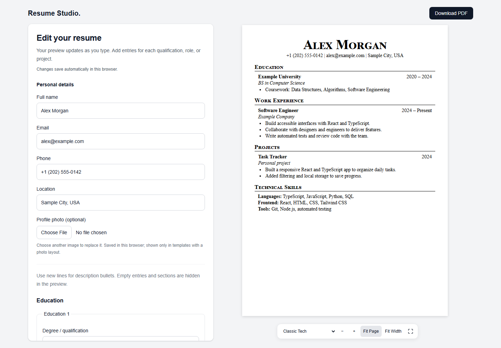
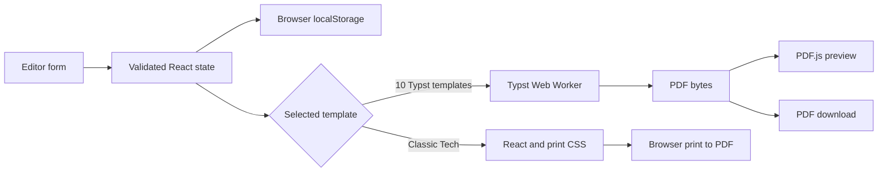

# Resume Studio

**A private-by-default resume editor with interchangeable templates and PDF export.**

Resume Studio is a lightweight, account-free resume builder. Enter your information once, compare it across several layouts, preview the result, and export a PDF without sending resume content to an application server.

## Live Demo

**[Open Resume Studio](https://edward-ren.github.io/resume_studio/)**

The public demo is deployed from `main` through GitHub Actions and GitHub Pages.



## Create and Export a Resume

1. Open the demo and select **Use Template** on a layout you like.
2. Replace the sample details and add entries for your education, experience, and projects. The preview updates as you edit.
3. Use the template selector below the preview to compare layouts; your edits are saved automatically in this browser.
4. Select **Download PDF** when your resume is ready. Classic Tech opens the browser's print dialog; choose **Save as PDF** there.

Resume content stays in the current browser and is not backed up or synced. On a shared device, clear this site's data when you're finished; doing so removes the saved resume.

## Why Resume Studio?

Resume builders often separate editing, template selection, and export into different steps. Some also require an account before users can evaluate the result. Resume Studio keeps the workflow deliberately small: one shared data model feeds every template, template changes do not reset the form, and rendering happens in the browser.

## Features

- [x] Edit contact details, education, experience, projects, and skills in one form
- [x] Add and remove repeatable resume entries
- [x] Switch between 11 templates without re-entering content
- [x] Preview multi-page output with fit, zoom, and fullscreen controls
- [x] Export 10 templates as PDFs compiled by Typst in the browser
- [x] Print the Classic Tech template to PDF through the browser print dialog
- [x] Save and validate resume data in the current browser with `localStorage`
- [x] Resize optional profile photos locally and use them in supported templates
- [x] Work without accounts, a database, or a rendering API

## Technology Stack

| Layer | Technology | Purpose |
| --- | --- | --- |
| Application | [Next.js 16.4.6](https://nextjs.org/docs) App Router | Static routes, metadata, navigation, and production export |
| UI | [React 19.3.0](https://react.dev/) | Interactive editor and preview controls |
| Language | [TypeScript 5.9.3](https://www.typescriptlang.org/docs/) | Strictly typed resume data and rendering pipeline |
| Styling | [Tailwind CSS 4.3.3](https://tailwindcss.com/docs) and scoped CSS | Responsive application and printable resume layouts |
| PDF compilation | [Typst.ts 0.8.0-rc4](https://github.com/Myriad-Dreamin/typst.ts) and WebAssembly | Client-side compilation of vendored Typst templates |
| PDF preview | [PDF.js 6.5.438](https://mozilla.github.io/pdf.js/) | Canvas rendering of generated PDF pages |
| Persistence | [`localStorage`](https://developer.mozilla.org/en-US/docs/Web/API/Window/localStorage) | Per-origin, browser-local resume storage |
| Delivery | GitHub Actions and GitHub Pages | Checked static builds and hosting |

The static architecture is intentional. This product does not need authentication, a database, containers, or a render server. A Web Worker keeps Typst compilation off the UI thread; bundling template packages and fonts makes rendering reproducible and avoids runtime package services.

## How It Works



The home page and editor are prerendered as static HTML. In the editor, all templates consume the same `ResumeData` object. Selecting a template only changes the renderer and URL query parameter; it does not replace the data. Typst adapters convert the shared model to template-specific input, compile it in a browser worker, and return one PDF byte array used by both preview and download.

## Getting Started

### Prerequisites

- Node.js 22 (the version used in CI)
- npm

### Install and run

```bash
git clone https://github.com/Edward-Ren/resume_studio.git
cd resume_studio
npm ci
npm run dev
```

Open [http://localhost:3000](http://localhost:3000).

The `predev` script automatically copies the vendored Typst adapters, packages, fonts, and compiler WebAssembly file into the ignored `public/typst/` directory. No separate Typst installation or environment variables are required.

### Production build

```bash
npm run build
```

This prepares the same assets and creates a static export in `out/`. Setting `GITHUB_PAGES=true` adds the `/resume_studio` base path used by the deployment workflow.

## Development Progress

### Requirements

- [x] The core problem, target workflow, MVP features, and account-free scope are defined
- [x] Authentication, payments, cloud sync, and server-side storage are explicit non-goals

### Design

- [x] One resume model is shared by the editor and all templates
- [x] Static hosting and in-browser rendering match the product's privacy and cost goals
- [x] Template adapters isolate unavoidable differences in upstream Typst packages
- [ ] Formal usability and accessibility reviews have been completed

### Implementation

- [x] Resume editing, repeatable sections, template switching, preview, and persistence are implemented
- [x] Typst PDF download and Classic Tech browser-print export are implemented
- [x] Invalid or unavailable saved data and rendering failures have user-facing fallbacks

### Quality Assurance

- [x] ESLint, strict TypeScript validation, static production build, and template compilation tests pass
- [x] Typst tests cover all 10 templates with normal, empty, special-character, long, and photo inputs
- [ ] The complete browser workflow is covered by automated end-to-end tests
- [ ] PDF appearance, mobile behavior, accessibility, and multiple browsers have a documented regression matrix

### Deployment

- [x] A reproducible static export and GitHub Pages workflow are configured
- [x] The current `main` deployment completed successfully and the public URL is reachable
- [ ] Performance and Core Web Vitals have been measured in production

### Maintenance

- [x] Direct dependencies are lockfile-pinned and CI runs lint, template tests, and a build
- [x] Upstream template sources, versions, licenses, and notices are retained
- [ ] Automated browser regression testing and dependency update automation are configured
- [ ] Resume Studio itself has an explicit project license

## Testing and Quality

Run the checks currently supported by the repository:

```bash
npm run lint
npx --no-install tsc --noEmit
npm run test:templates
npm run build
npm audit --omit=dev --audit-level=high
```

During the latest repository audit, all five commands passed. The template test compiles 50 representative documents: five input scenarios across 10 Typst templates. The production build also performs Next.js TypeScript validation and prerenders `/` and `/editor`.

There is no automated browser test suite yet. Editing, template switching, refresh restoration, PDF.js preview, download behavior, browser printing, keyboard use, responsive behavior, and cross-browser output therefore remain unverified as complete user workflows.

## Roadmap / TODO

### High priority

- [ ] **Medium:** Add focused Playwright tests for edit, add/delete, template switch, refresh persistence, preview readiness, and PDF download
- [ ] **Medium:** Establish PDF visual/regression fixtures for all templates, long content, page breaks, and Classic Tech printing
- [ ] **Medium:** Add JSON export/import and an explicit reset action so browser storage is not the only recovery path
- [ ] **Medium:** Complete a WCAG 2.2 keyboard, focus, contrast, screen-reader, and zoom audit; fix confirmed issues
- [ ] **Small:** Choose and add a project license; the third-party licenses do not license Resume Studio's original code

### Medium priority

- [ ] **Medium:** Verify the critical workflow on current Chromium, Firefox, WebKit/Safari, and representative mobile viewports
- [ ] **Small:** Add an application-level error boundary and clearer recovery actions for failed compiler or asset initialization
- [ ] **Medium:** Measure first render, first Typst compile, transferred assets, and Core Web Vitals before optimizing the asset pipeline

### Low priority

- [ ] **Medium:** Evaluate optional fields such as a summary and portfolio links only after validating demand and template support
- [ ] **Small:** Add a lightweight in-app feedback link to the repository issue tracker

## Limitations

- Resume data is stored under `resume-studio:resume:v1` in one browser origin. It is not synced or backed up, and clearing site data removes it.
- The shared schema intentionally omits several template-specific fields. Upstream templates may therefore expose only a subset of their native capabilities.
- Profile photos appear only in templates with a suitable native photo layout.
- The generated static export is about 62 MiB because it includes the WebAssembly compiler and vendored template/font assets. The browser requests the selected template's manifest assets, but first-time Typst rendering can still be comparatively heavy.
- Classic Tech PDF output depends on browser print settings; users should select A4, 100% scale, and disable browser headers and footers.
- Automated tests validate Typst compilation and PDF signatures, not visual fidelity or the end-to-end browser experience.

## Credits and License

Resume Studio adapts established open-source resume templates rather than presenting them as original designs.

| Template | Author / source | Declared license |
| --- | --- | --- |
| Classic Tech | [Jake Gutierrez, Jake's Resume](https://github.com/jakegut/resume) | MIT |
| Classic Professional | [Super Lede, readable-classic 0.1.0](https://github.com/typst/packages/tree/main/packages/preview/readable-classic/0.1.0) | MIT and MIT-0 |
| Academic CV | [Mikkel Roald-Arbøl and Je Sian Keith Herman, academicv 1.1.0](https://github.com/typst/packages/tree/main/packages/preview/academicv/1.1.0) | Apache-2.0 |
| Modern Professional | [Paul Tsouchlos, modern-cv 0.10.0](https://github.com/typst/packages/tree/main/packages/preview/modern-cv/0.10.0) | MIT |
| Sidebar Professional | [Vikram Saraph, cobalt-cv 0.1.0](https://github.com/typst/packages/tree/main/packages/preview/cobalt-cv/0.1.0) | MIT |
| Editorial | [tsnobip, typographic-resume 0.2.0](https://github.com/tsnobip/typst-typographic-resume) | MIT |
| Bold & Colorful | [Loïc Fontaine, vivid-cv 0.2.0](https://github.com/typst/packages/tree/main/packages/preview/vivid-cv/0.2.0) | MIT |
| Creative Sidebar | [Pierre Guyot, toy-cv 0.1.0](https://github.com/typst/packages/tree/main/packages/preview/toy-cv/0.1.0) | MIT-0 (an MIT file is also retained upstream) |
| Modern Two-Column | [Shane Murphy, altacv 1.7.0](https://github.com/typst/packages/tree/main/packages/preview/altacv/1.7.0) | MIT |
| Clean & Refined | [Diego Alvarez S., neat-cv 1.2.0](https://github.com/typst/packages/tree/main/packages/preview/neat-cv/1.2.0) | MIT |
| European CV | [rasko--, rasko-europass 1.0.0](https://github.com/typst/packages/tree/main/packages/preview/rasko-europass/1.0.0) | MIT |

The original package archives, manifests, READMEs, license files, and notices are retained under `typst/packages/preview/`. Required Typst package dependencies (`fontawesome`, `datify`, `datify-core`, `gairm-import`, `linguify`, and `zebra`) are vendored there as well. Bundled fonts retain their OFL, Apache-2.0, or Font Awesome notices under `typst/fonts/`.

<details>
<summary>MIT notices for Classic Tech and typographic-resume</summary>

Classic Tech is a React/CSS visual adaptation of Jake's Resume. Copyright (c) 2020 Jake Gutierrez.

`typographic-resume` is by tsnobip. Its package manifest declares MIT; the upstream archive does not include a separate license file. Copyright tsnobip.

Permission is hereby granted, free of charge, to any person obtaining a copy of this software and associated documentation files (the "Software"), to deal in the Software without restriction, including without limitation the rights to use, copy, modify, merge, publish, distribute, sublicense, and/or sell copies of the Software, and to permit persons to whom the Software is furnished to do so, subject to the following conditions:

The above copyright notice and this permission notice shall be included in all copies or substantial portions of the Software.

THE SOFTWARE IS PROVIDED "AS IS", WITHOUT WARRANTY OF ANY KIND, EXPRESS OR IMPLIED, INCLUDING BUT NOT LIMITED TO THE WARRANTIES OF MERCHANTABILITY, FITNESS FOR A PARTICULAR PURPOSE AND NONINFRINGEMENT. IN NO EVENT SHALL THE AUTHORS OR COPYRIGHT HOLDERS BE LIABLE FOR ANY CLAIM, DAMAGES OR OTHER LIABILITY, WHETHER IN AN ACTION OF CONTRACT, TORT OR OTHERWISE, ARISING FROM, OUT OF OR IN CONNECTION WITH THE SOFTWARE OR THE USE OR OTHER DEALINGS IN THE SOFTWARE.

</details>

No license currently grants reuse rights for Resume Studio's original source code. Add a project-level license before describing the repository as MIT, Apache-2.0, or otherwise open source.

## Feedback and Contact

Found a bug or have an idea for improvement? [Open an issue](https://github.com/Edward-Ren/resume_studio/issues) or contact the maintainer through the [GitHub profile](https://github.com/Edward-Ren). Suggestions and feedback are welcome.
